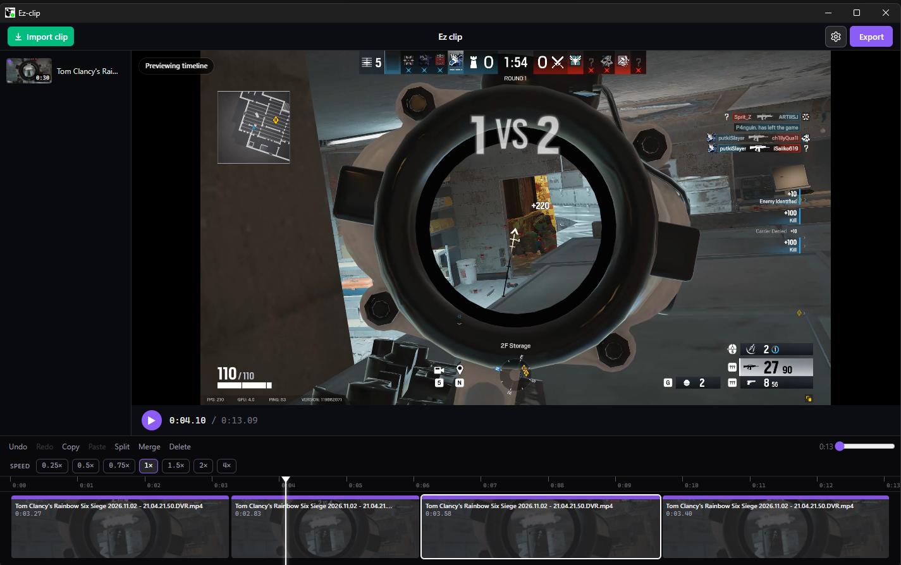

# EZ Clip

EZ Clip is a Windows desktop app for making short gaming clips easier. Import a recording, trim it on a timeline, join the parts you want, and export one file. File can be compressed to have a desired file size without compromising quality much.



## Download

Windows 64-bit.

[Download setup.exe](https://github.com/DortCeL/EZ-Clip/releases/download/v0.1.0/setup.exe) from the [latest release](https://github.com/DortCeL/EZ-Clip/releases).

Run `setup.exe` and choose an install folder. After that, open **EZ Clip** from the Start menu.

The installer is not code-signed, so Windows SmartScreen can show **Unknown publisher**. Choose **More info**, then **Run anyway**.

## What you can do

- Import one or many clips. Each import is added to the timeline automatically.
- Trim, split, merge, copy, paste, and reorder clips.
- Speed a clip up or slow it down. A sped-up stretch shows a fast-forward mark on the picture and in the export.
- Preview the original file or the timeline.
- Export **Lossless** (a direct copy of the picture) or **Optimal** (a smaller file that keeps the same look). Percentage qualities are there when you want a smaller file still.
- Name the export, pick the folder, and export again with a different name or quality.
- Optionally delete the source clips that were used in a successful export.

Exports go to `Videos/Ez-clip` until you change the folder in Settings.

## Using it

1. Click **Import clip**, or drop videos onto the window.
2. The clip lands in the source list and on the timeline.
3. Drag the playhead, split where you want a cut, and delete the parts you do not need.
4. Hover a clip to duplicate it. Hover the join between two clips of the same speed to merge them.
5. Click **Export**. Optimal is selected by default. Set a file name, change the folder if you want, then export.
6. A short “Exported” message appears in the middle of the dialog. The dialog stays open so you can export another version.

Supported imports: `.mp4`, `.mkv`, `.mov`, `.m4v`, `.webm`, `.ts`.

The edit is saved on this computer and restored the next time you open the app.

## Keyboard

| Key | Action |
| --- | --- |
| `Ctrl+O` | Import |
| `Ctrl+E` | Export |
| `Ctrl+,` | Settings |
| `Space` | Play / pause |
| `Tab` | Switch between original media and the timeline |
| `I` / `O` | Mark in / mark out on the source |
| `A` or `Enter` | Add the marked range to the timeline |
| `X` | Clear marks |
| `S` | Split at the playhead |
| `M` | Merge with the neighboring clip |
| `Q` / `W` | Trim the start / end of the selected clip to the playhead |
| `Delete` | Delete the selected clip |
| `Ctrl+C` / `Ctrl+V` | Copy / paste a clip |
| `Ctrl+Z` / `Ctrl+Y` | Undo / redo |
| `←` / `→` | Nudge the playhead |
| `J` / `K` / `L` | Shuttle back / stop / shuttle forward |

## Build from source

You need Node.js 20 or newer and Windows 64-bit.

```bash
npm install
npm run dev
```

To build the installer:

```bash
npm run dist
```

The installer is written to `release/setup.exe`.

## License

MIT
